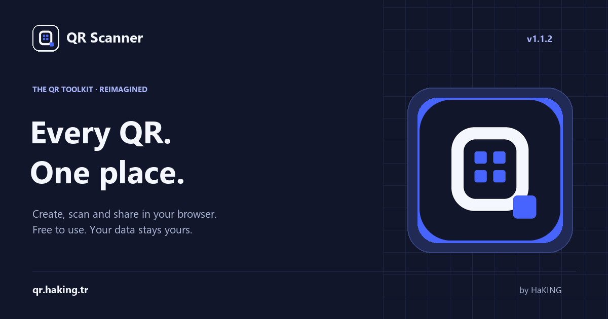

<p align="center"></p>
<h1 align="center">QR Scanner</h1>
<p align="center">Scan. Create. Carry on.<br>A private QR toolkit for the web and your browser.</p>
<p align="center"><a href="https://qr.haking.tr/">Website</a> · <a href="https://qr.haking.tr/#extension">Download</a> · <a href="https://qr.haking.tr/help.html">Installation</a> · <a href="https://qr.haking.tr/privacy.html">Privacy</a></p>



## Türkçe

QR Scanner; ücretsiz QR kod oluşturma, QR kod okuma ve tarayıcı uzantısını
bir araya getiren açık kaynaklı bir projedir. Web sitesi, metin, Wi-Fi,
e-posta, telefon, SMS ve kişi kartı QR kodları oluşturur. PNG/SVG dışa aktarma, sürükleyip bırakma,
görsel yapıştırma, otomatik dil, açık/koyu/sistem temaları desteklenir.
QR içeriği ve görseller cihazda işlenir. Hesap ve filigran yoktur.

**Sürüm: 1.1.2.** Yenilenen site, bağımsız 390px uzantı arayüzü,
okunaklı dil/tema menüleri ve tarayıcıya özel kurulum akışı.
İletişim: [qr@haking.tr](mailto:qr@haking.tr).

## Features

- Seven QR types, UTF-8, live preview, error correction and hidden Wi-Fi support.
- PNG (512/1024/2048px) and scalable SVG; four-module quiet zone.
- Local PNG/JPEG/WebP image scanning, paste and drag/drop (15 MB maximum).
- Scan active browser tab in the extension with a user gesture.
- Create a QR for the current tab; copy generated images to the clipboard.
- On-demand local camera scanning on the website; camera stops after a result.
- Every ZIP download opens the matching browser installation guide automatically.
- Automatic browser language, manual language choice, persistent theme.
- Static localized HTML, canonical/hreflang links, sitemap, structured data.
- Extension only shows the update notice when the release is newer.
- No analytics, server-side QR processing, tracking cookies or QR history.

## Browser availability

| Platform | Installation/status |
| --- | --- |
| Edge | [Existing store listing](https://microsoftedge.microsoft.com/addons/detail/qr-scanner/klblmhlgnbnclpdhddadkbbccmdjknmf); submitting 1.1.2 requires the owner's store account. |
| Chrome / Edge / Brave / Opera | Load the Chromium ZIP unpacked in Developer mode. Store listings are not implied. |
| Firefox 142+ | Separate MV3 package with Gecko ID and no-data declaration. Temporary installation via about:debugging; Mozilla signing is required for permanent installation. |
| Safari | Website works in modern Safari. Native extension conversion/signing with Xcode and Apple distribution is still required. No Safari package is claimed. |

The extension requests `activeTab` for explicitly initiated screenshots and
`https://qr.haking.tr/*` for version checks. No content scripts or broad
browsing permissions. Version checks run on popup opening at most once per
hour, send no QR contents, and silently tolerate being offline. Checks
cannot be retroactively added to older installed versions.

## Development

Requires Node.js 20+ and Python 3.10+. Runtime is plain HTML/CSS/JS.

```sh
npm ci
npm test
npm run build
python -m http.server 4173
```

Open `http://localhost:4173`. `tools/build.py` renders all localized HTML,
copies shared runtime into `extension/`, and creates Chromium/Firefox ZIPs
and SHA-256 checksums in `downloads/`. `shared/locales.json` is the source
for translations. `tools/templates.py` contains website and compact popup layouts.
`shared/ui.css` holds design tokens/controls; `style.css` is website-only and
`popup.css` fixes actual browser-popup geometry without viewport-relative shrinking.
Branding can be rebuilt with its documented
asset script (Pillow dependency only for that optional workflow).

## Release and deployment

Read [RELEASING.md](RELEASING.md). This repository retains root `index.html`
compatibility with the existing site and local preview. The actual production
host is the GitHub-connected Cloudflare Worker named `qr`.
No new hosting service, account, database or Cloudflare project is required.
`_headers` supplies CSP, MIME protection, referrer policy and no-cache release
metadata. Pushes to the existing production branch use the existing
GitHub → Cloudflare integration. Review the actual deployment result.

Cloudflare build command: `npm run build:static`. Deploy command:
`npx wrangler deploy --name qr --assets ./dist --compatibility-date 2026-10-19`.
This preserves the existing Wrangler-based Git deployment without adding a
new CLI configuration file. `dist/` contains only public site assets and
download packages. Python builds the committed release locally, not on hosting.

## Contributing and security

See [CONTRIBUTING.md](CONTRIBUTING.md), [SECURITY.md](SECURITY.md),
[CHANGELOG.md](CHANGELOG.md), [third-party notices](THIRD_PARTY_NOTICES.md).
MIT © 2026 Halit (HaKING). [haking.tr](https://haking.tr/).

## Verified for 1.1.2

Website generation/decoding and overflow at 390px and 768px; all four non-store
ZIP download-to-guide paths; real Chromium extension loading/generation/PNG
download/decoding/language changes; camera decoding using an injected video
fixture; Firefox package lint with zero errors and warnings. Store submission
and Safari conversion remain separate distribution steps.
